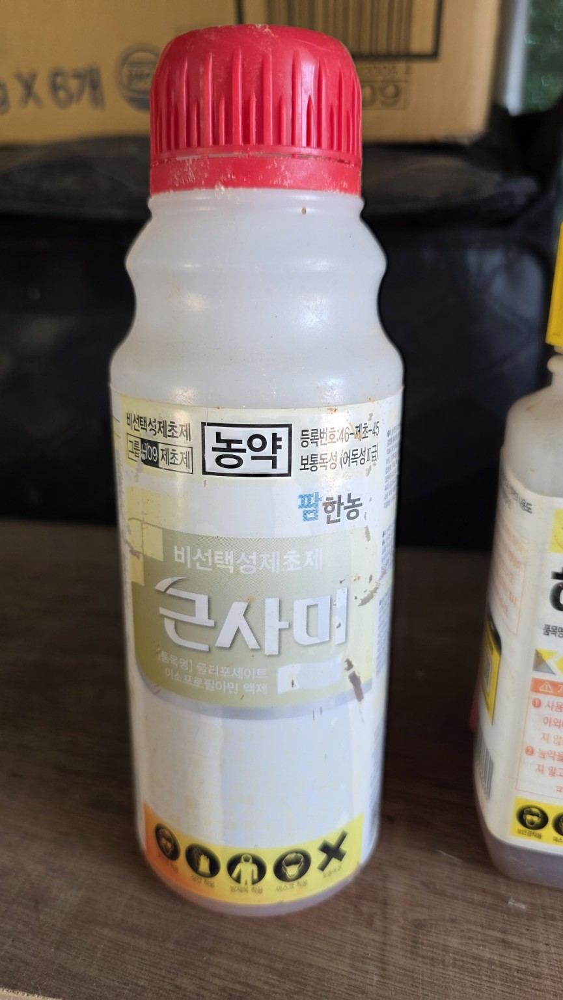
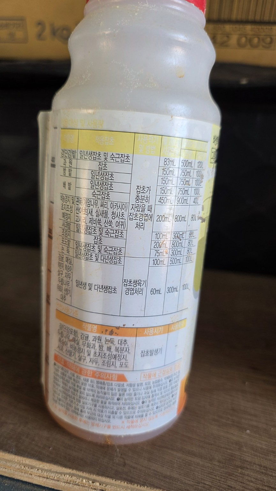
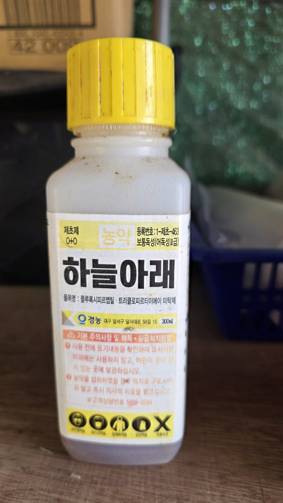
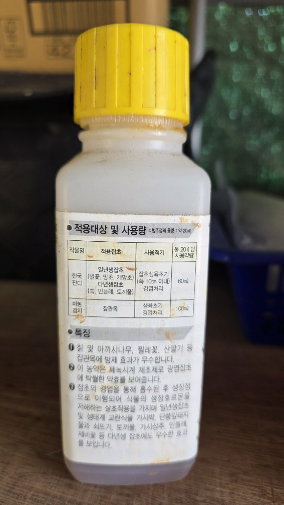
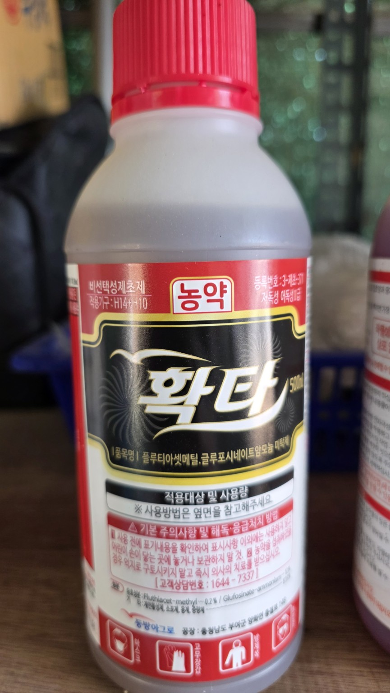
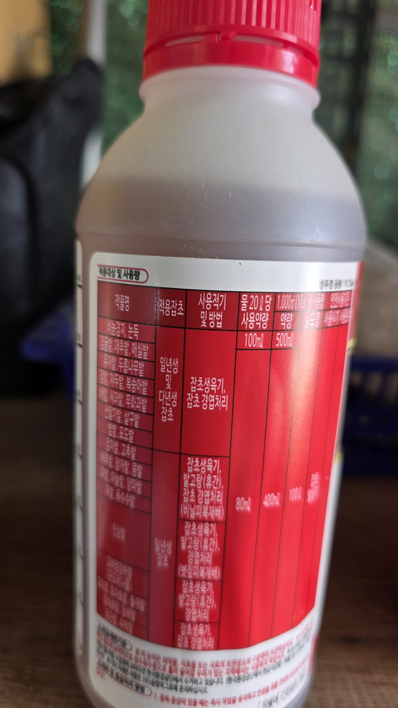
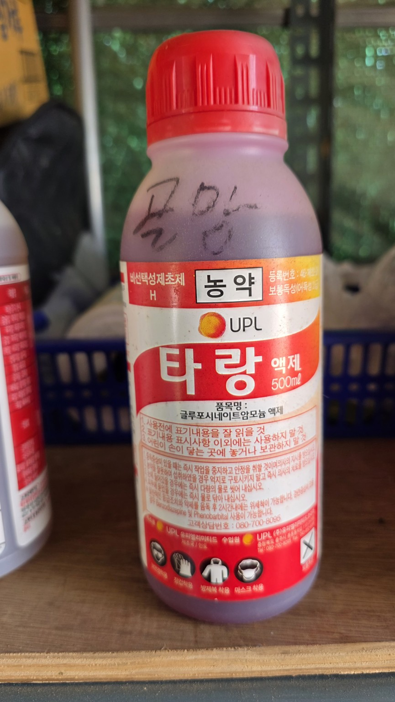
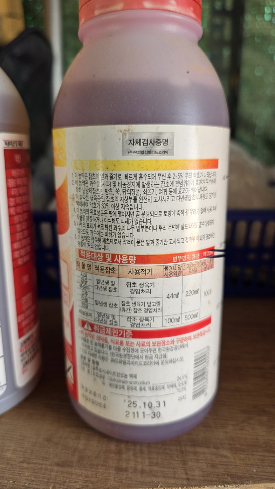

# 🌿 화곡농장 보유 농약 관리대장

4개 제품 · 원본 사진 8장 · 농약사 상담 기록

**주의:** 실제 살포 전 제품 라벨과 최신 등록정보를 확인하세요. 비선택성
제초제는 재배작물에 닿으면 약해를 유발할 수 있습니다.

| 제품     | 유효성분                                    | 분류                         | 용도                  | 앞면 / 뒷면 (확대)                                                                       |
|----------|---------------------------------------------|------------------------------|-----------------------|------------------------------------------------------------------------------------------|
| 큰사미   | 글리포세이트 이소프로필아민염               | 비선택성 / 이행성            | 다년생 잡초 경엽처리  |                                                                       |
| 하늘아래 | 플루록시피르멥틸 + 트리클로피르트리에틸아민 | 광엽·목본 잡초 대상 / 이행성 | 칡·찔레 등 등록 잡초  |                                                                     |
| 확타     | 플루티아세트메틸 + 글루포시네이트암모늄     | 비선택성 / 접촉작용 중심     | 생육 중 잡초 경엽처리 |                                                                         |
| 타랑     | 글루포시네이트암모늄                        | 비선택성 / 접촉작용 중심     | 생육 중 잡초 경엽처리 |                                                                         |

## 용어 설명

**비선택성**: 작물과 잡초 모두에 피해 가능 · **선택성**: 특정 잡초군에
선택적으로 작용 · **이행성**: 식물체 내 이동 · **접촉작용**: 닿은 부위
중심으로 작용

## 농약사 상담 (2026-06-05)

감자밭과 엄나무 주변 제초에 대해 약해 위험을 경고하고, 다른
제품(프리타·프렌장으로 들림)을 권고했습니다. 상담 내용은 참고 의견이며,
정확한 제품명과 등록사항은 별도 확인이 필요합니다.

타랑은 접촉작용이 강한 글루포시네이트 계열이지만, 작물 주변에 무조건
안전한 것은 아닙니다.

[상담 원문 열기](농약사_상담원문.txt) · [Markdown 원본](README.md)

닫기 ✕

