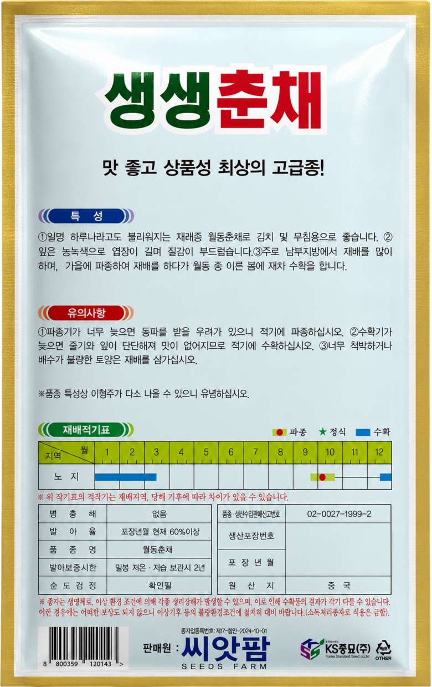
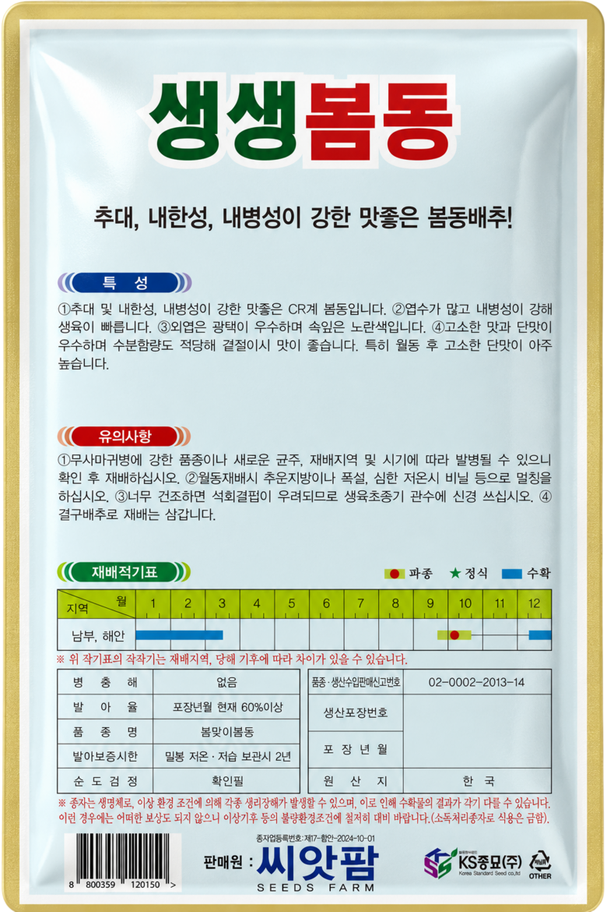
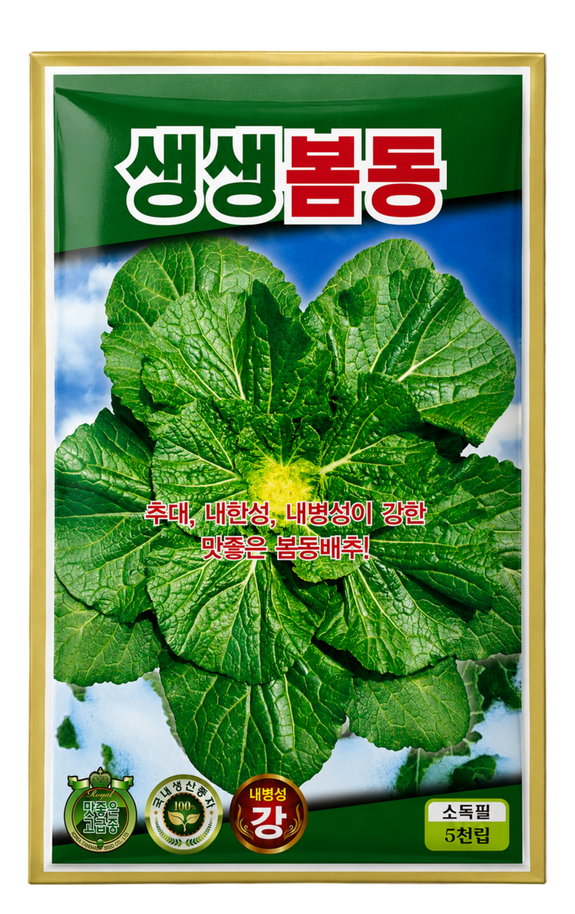
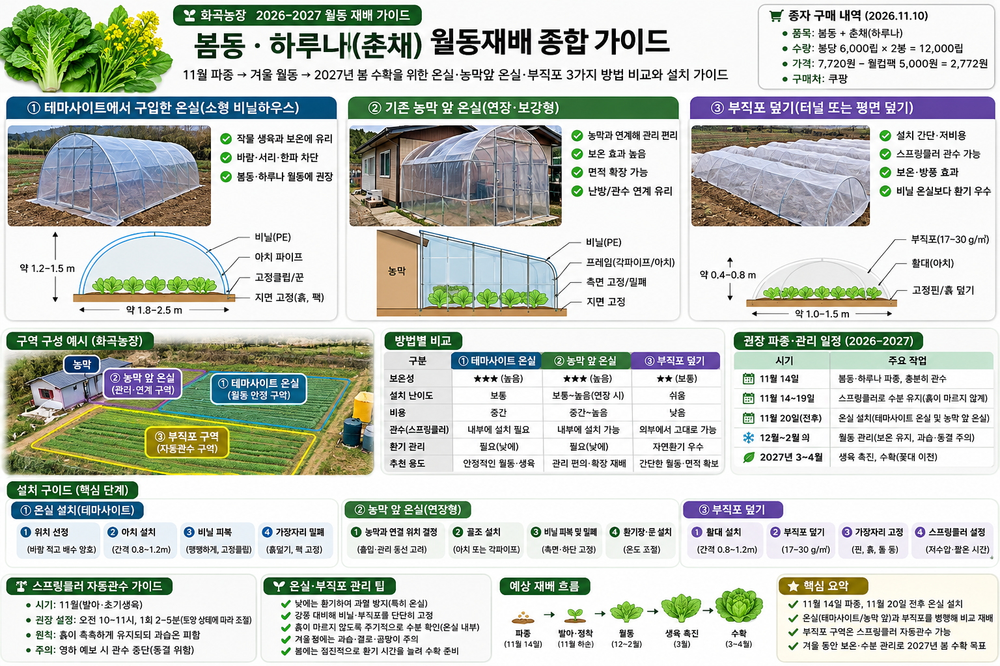

[프로젝트
홈](https://softm.github.io/projects/hwagok-farm/)<a href="README.md" download="">MD 다운로드</a><a href="manifest.json" download="">파일 목록·해시</a>[사진·도식
뷰어](#gallery)

# 20261110 봄동·하루나 구매 및 월동 재배

테무 구매 온실 · 기존 농막 앞 온실 · 부직포 덮기 비교 및
파종·관수·월동·봄철 수확 가이드

## 사진·도식 통합 뷰어 (총 5장)

사진을 누르면 전체 화면으로 확대됩니다. 이전·다음, 키보드 방향키, 원본
열기 및 다운로드를 지원합니다.

<figure>

<figcaption>봄동·하루나 종자 포장 사진 1 <a href="images/photo_01.png"
download="">원본 다운로드</a></figcaption>
</figure>

<figure>

<figcaption>봄동·하루나 종자 포장 사진 2 <a href="images/photo_02.png"
download="">원본 다운로드</a></figcaption>
</figure>

<figure>

<figcaption>봄동·하루나 종자 포장 사진 3 <a href="images/photo_03.png"
download="">원본 다운로드</a></figcaption>
</figure>

<figure>

<figcaption>봄동·하루나 종자 포장 사진 4 <a href="images/photo_04.png"
download="">원본 다운로드</a></figcaption>
</figure>

<figure>

<figcaption>온실·부직포 3가지 방법 비교 개념도 <a
href="images/wintering_methods_concept.png" download="">원본
다운로드</a></figcaption>
</figure>

# 20261110 화곡농장 봄동·춘채(하루나) 구매 및 월동 파종 계획

## 구매 내역

| 항목 | 내용 |
|----|----|
| 구매처 | 쿠팡 |
| 상품 링크 | https://www.coupang.com/vp/products/9663151900 |
| 구매일 | 2026-11-10 |
| 품목 | 봄동(봄맛이봄동), 춘채(월동춘채·하루나) |
| 수량 | 2봉 |
| 사용자 안내 수량 | 각 6,000립 (봄동 포장 사진은 5,000립 표기로 상충, 확인 필요) |
| 상품 표시가 | 7,720원 |
| 웰컴팩 할인 | 5,000원 |
| 사용자 확인 결제금액 | 2,772원 |
| 금액 차이 | 표시가-할인=2,720원으로 결제액과 52원 차이, 원인 미확인 |

## 파종 및 월동 계획

| 시기 | 계획 | 주의 |
|----|----|----|
| 11월 14일 | 봄동·하루나 파종 | 파종 깊이 약 0.5~1cm, 파종 직후 관수 |
| 11월 14~20일 | 스프링클러로 수분 관리 | 흙 상태 확인, 과습·동결 방지 |
| 11월 20일 전후 | 미니 온실 설치 및 부직포 구역 구분 | 서리·영하 예보면 설치 앞당김 |
| 12~2월 | 월동 | 온실은 난방이 아니므로 한파 대비, 건조·과열 확인 |
| 2027년 3~4월 | 생육 회복 및 수확 목표 | 꽃대가 올라오기 전 수확, 늦서리 주의 |

## 온실과 부직포 구역 비교

- **온실:** 비가 직접 들어오지 않으므로 파종 후 수분이 유지되는지
  점검하고 필요 시 내부 관수. 낮 과열 시 환기, 강풍 대비 고정.
- **부직포:** 물이 통과하는 농업용 부직포라면 외부 스프링클러 활용 가능.
  실제 토양 도달 여부 확인.
- 기존 '2시간마다 1분' 관수를 무조건 적용하지 말고 토양 상태·유량·기온에
  맞춰 조절.
- 11월 중순 파종은 권장 적기보다 늦어 발아·월동 성공이 보장되지 않음.
- 씨앗 상태로 겨울을 넘겨 봄에 발아할 가능성은 있으나, 월동 전 발아해
  뿌리내린 포기보다 봄 수확이 늦어질 수 있음.

## 첨부 원본 이미지

## 온실·부직포 3가지 방법 비교 (보완)

> 위 이미지는 **설치 원리 개념도**이며 실제 테무 구매 제품의 크기·모양,
> 농막 앞 온실의 구조, 정확한 구매 수량을 검증한 시공도가 아닙니다.
> 이미지 속 구매 수량과 금액은 원자료와 다를 수 있으므로 아래 표를
> 우선합니다.

| 구역 | 구성 | 물주기 | 주의사항 |
|----|----|----|----|
| 테무 구매 온실 | 노지 위 구매 온실 설치 | 비닐이 비를 차단하면 내부 직접 관수 | 제품 치수·고정 방법 미확인, 강풍 고정과 낮 환기 필수 |
| 농막 앞 기존 온실 | 기존 시설 안에 파종 구역 확보 | 기존 급수 연결 여부 확인 | 기존 온실 구조·온도·작물 간섭 미확인 |
| 부직포 구역 | 활대 위 부직포 또는 느슨하게 덮기 | 투수성 부직포면 외부 스프링클러 사용 가능 | 실제 토양 도달 확인, 영하 관수 피하고 가장자리 고정 |

### 단계별 작업

1.  **11월 14일:** 배수 좋은 두둑에 봄동·하루나를 나눠 0.5~1cm 깊이로
    파종하고 충분히 관수.
2.  **11월 14~19일:** 스프링클러로 표토가 마르지 않도록 관리하되
    2시간마다 1분 설정을 무조건 유지하지 않음.
3.  **11월 20일 전후:** 온실 설치. 서리·영하 예보가 있으면 앞당김.
    부직포 구역은 외부 관수 도달 확인.
4.  **12~2월:** 온실 내부 토양 수분 확인, 낮 과열 시 환기, 강풍 시 고정
    상태 점검. 난방 없는 온실은 영하로 내려갈 수 있음.
5.  **2027년 3~4월:** 낮부터 단계적으로 개방하고 늦서리 예보 확인.
    꽃대가 올라오기 전에 수확.

### 실제 구매 내역 재확인

- 2봉(봄동 + 춘채/하루나), 쿠팡 상품 표시가 7,720원, 웰컴팩 5,000원
  할인, 사용자 확인 결제 2,772원. 차액 52원은 미확인.
- 봄동 사진은 **5천립**, 춘채 사진은 **6천립**으로 표기됨. 구매 옵션의
  '각 6천립' 안내와 상충하므로 사진 기준을 명시.

Markdown 원문 인라인 보기

    # 20261110 화곡농장 봄동·춘채(하루나) 구매 및 월동 파종 계획

    ## 구매 내역
    | 항목 | 내용 |
    |---|---|
    | 구매처 | 쿠팡 |
    | 상품 링크 | https://www.coupang.com/vp/products/9663151900 |
    | 구매일 | 2026-11-10 |
    | 품목 | 봄동(봄맛이봄동), 춘채(월동춘채·하루나) |
    | 수량 | 2봉 |
    | 사용자 안내 수량 | 각 6,000립 (봄동 포장 사진은 5,000립 표기로 상충, 확인 필요) |
    | 상품 표시가 | 7,720원 |
    | 웰컴팩 할인 | 5,000원 |
    | 사용자 확인 결제금액 | 2,772원 |
    | 금액 차이 | 표시가-할인=2,720원으로 결제액과 52원 차이, 원인 미확인 |

    ## 파종 및 월동 계획
    | 시기 | 계획 | 주의 |
    |---|---|---|
    | 11월 14일 | 봄동·하루나 파종 | 파종 깊이 약 0.5~1cm, 파종 직후 관수 |
    | 11월 14~20일 | 스프링클러로 수분 관리 | 흙 상태 확인, 과습·동결 방지 |
    | 11월 20일 전후 | 미니 온실 설치 및 부직포 구역 구분 | 서리·영하 예보면 설치 앞당김 |
    | 12~2월 | 월동 | 온실은 난방이 아니므로 한파 대비, 건조·과열 확인 |
    | 2027년 3~4월 | 생육 회복 및 수확 목표 | 꽃대가 올라오기 전 수확, 늦서리 주의 |

    ## 온실과 부직포 구역 비교
    - **온실:** 비가 직접 들어오지 않으므로 파종 후 수분이 유지되는지 점검하고 필요 시 내부 관수. 낮 과열 시 환기, 강풍 대비 고정.
    - **부직포:** 물이 통과하는 농업용 부직포라면 외부 스프링클러 활용 가능. 실제 토양 도달 여부 확인.
    - 기존 '2시간마다 1분' 관수를 무조건 적용하지 말고 토양 상태·유량·기온에 맞춰 조절.
    - 11월 중순 파종은 권장 적기보다 늦어 발아·월동 성공이 보장되지 않음.
    - 씨앗 상태로 겨울을 넘겨 봄에 발아할 가능성은 있으나, 월동 전 발아해 뿌리내린 포기보다 봄 수확이 늦어질 수 있음.

    ## 첨부 원본 이미지

    

    

    

    

    ## 온실·부직포 3가지 방법 비교 (보완)

    

    > 위 이미지는 **설치 원리 개념도**이며 실제 테무 구매 제품의 크기·모양, 농막 앞 온실의 구조, 정확한 구매 수량을 검증한 시공도가 아닙니다. 이미지 속 구매 수량과 금액은 원자료와 다를 수 있으므로 아래 표를 우선합니다.

    | 구역 | 구성 | 물주기 | 주의사항 |
    |---|---|---|---|
    | 테무 구매 온실 | 노지 위 구매 온실 설치 | 비닐이 비를 차단하면 내부 직접 관수 | 제품 치수·고정 방법 미확인, 강풍 고정과 낮 환기 필수 |
    | 농막 앞 기존 온실 | 기존 시설 안에 파종 구역 확보 | 기존 급수 연결 여부 확인 | 기존 온실 구조·온도·작물 간섭 미확인 |
    | 부직포 구역 | 활대 위 부직포 또는 느슨하게 덮기 | 투수성 부직포면 외부 스프링클러 사용 가능 | 실제 토양 도달 확인, 영하 관수 피하고 가장자리 고정 |

    ### 단계별 작업
    1. **11월 14일:** 배수 좋은 두둑에 봄동·하루나를 나눠 0.5~1cm 깊이로 파종하고 충분히 관수.
    2. **11월 14~19일:** 스프링클러로 표토가 마르지 않도록 관리하되 2시간마다 1분 설정을 무조건 유지하지 않음.
    3. **11월 20일 전후:** 온실 설치. 서리·영하 예보가 있으면 앞당김. 부직포 구역은 외부 관수 도달 확인.
    4. **12~2월:** 온실 내부 토양 수분 확인, 낮 과열 시 환기, 강풍 시 고정 상태 점검. 난방 없는 온실은 영하로 내려갈 수 있음.
    5. **2027년 3~4월:** 낮부터 단계적으로 개방하고 늦서리 예보 확인. 꽃대가 올라오기 전에 수확.

    ### 실제 구매 내역 재확인
    - 2봉(봄동 + 춘채/하루나), 쿠팡 상품 표시가 7,720원, 웰컴팩 5,000원 할인, 사용자 확인 결제 2,772원. 차액 52원은 미확인.
    - 봄동 사진은 **5천립**, 춘채 사진은 **6천립**으로 표기됨. 구매 옵션의 '각 6천립' 안내와 상충하므로 사진 기준을 명시.

<a href="README.md" download="">Markdown 원본 다운로드</a>

